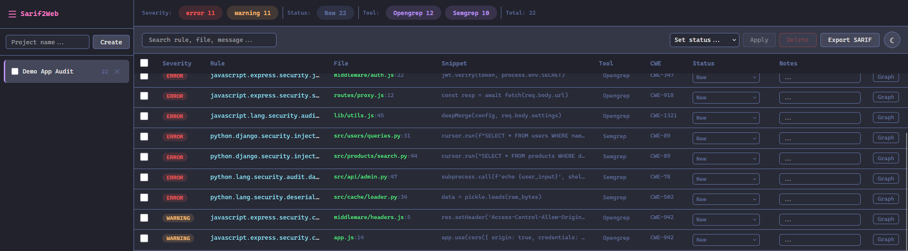
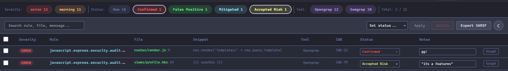
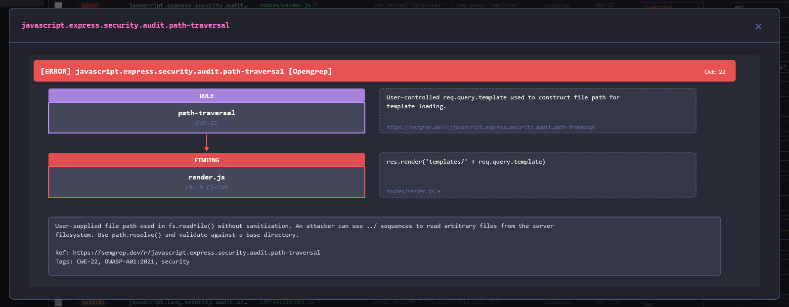
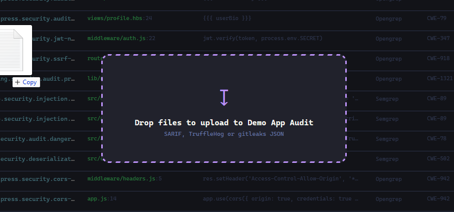

# Sarif2Web

> Built with [Claude Code](https://claude.ai/code)

Web app to manage and review security findings from SARIF and JSON files. Run scanners, upload reports, correlate results across tools, triage, visualize code flows and export.

**This is a local tool, not a production service.** It's meant to run on your machine via Docker Compose during an audit or triage session. There is no authentication, no user management, no HTTPS.

## Supported Tools

| Tool               | Status | Command                                                                       |
|------------------  |--------|-------------------------------------------------------------------------------|
| Semgrep / Opengrep | Tested | `semgrep scan --sarif --sarif-output=scan.sarif`                              |
| CodeQL             | Tested | `codeql database analyze codeql-db codeql/python-queries:codeql-suites/python-security-extended.qls --format=sarifv2.1.0 --output=scan.sarif` (Python example) |
| Snyk Open Source   | Supported | `snyk test --all-projects --sarif-file-output=scan.sarif`                  |
| Snyk Code          | Supported | `snyk code test --sarif-file-output=scan.sarif`                            |
| Gitleaks           | Tested | `gitleaks detect --source=. --report-format=sarif --report-path=scan.sarif`   |
| TruffleHog         | Tested | `trufflehog git https://github.com/repo.git --json > results.jsonl`           |

Any tool that outputs valid SARIF should work.

## Screenshots

These screenshots show the earlier interface. The current UI uses a slate and mint palette, a compact project header, overview counters and larger finding text.

Dashboard


Filters & triage


Graph view


Drag & drop upload


## Features

- **Drag & drop upload** : drop `.sarif`, `.json` or `.jsonl` files anywhere on the page, auto-creates a project if none is selected
- **Multi-format** : SARIF, gitleaks JSON, TruffleHog JSONL
- **Multi-file projects** : manual imports deduplicate against existing findings. Integrated scans conservatively group matching observations into one finding, preserving its triage across runs and keeping each tool's details and scan origin.
- **Integrated scanning** : launch scans from the UI with a Git repo URL (see [Integrated Scanners](#integrated-scanners))
- **Multi-tool correlation** : group confidently matching results into one finding while keeping each tool's observations
- **Potential duplicates** : flag related findings for review without automatically merging uncertain matches
- **Scan observations** : expand a finding to inspect each tool's rule, severity, message, snippet, code flows and scan ID
- **Rescan continuity** : preserve status and notes when a later scan matches an existing finding
- **Private GitHub repositories** : clone with the GitHub token from Settings, including repositories owned by another account when your token has access
- **Multi-language CodeQL** : analyze every detected supported language, track per-language progress and retain successful results when another language fails
- **Separate Snyk modes** : select dependency analysis, source-code analysis or both with one shared token
- **Settings & tokens** : configure API tokens (Semgrep, Snyk, GitHub) via the gear icon, encrypted and stored in MongoDB
- **Filter bar** : filter by severity, status, tool from the stats bar or table cells
- **Search** : full-text across rule IDs, file paths, messages, snippets
- **Status tracking** : triage as New, Confirmed, False Positive, Mitigated, Accepted Risk
- **Bulk operations** : select multiple findings to update status or delete
- **Soft delete + undo** : deleted findings can be restored via the undo toast (6s)
- **Notes** : annotate findings
- **SVG code flow graphs** : visualize source-to-sink data flows
- **SARIF export** : preserve tool-specific observations with shared review metadata (status + notes), finding IDs and scan IDs
- **Dark / Light theme** : slate and mint workspace with overview counters, responsive layout and a theme persisted in local storage
- **Overview counters** : total findings, error severity, findings awaiting triage and confirmed findings for the selected project
- **Readable workspace** : compact header, 16 px main finding text, larger secondary text and code snippets, and layouts for desktop and mobile
- **Keyboard access** : focus indicators and keyboard-accessible filter buttons, with reduced-motion preferences respected

## Quick Start

```bash
docker compose build --no-cache
docker compose up
```

App available at **http://localhost:9090**

```bash
docker compose down        # stop services
docker compose down -v     # stop + wipe database
```

After updating the source, rebuild the application service:

```bash
docker compose up -d --build --no-deps flask
```

Reload the page to use the updated interface. This keeps the MongoDB volume and existing projects.

## Architecture

```
Browser --> Nginx (:9090) --> Flask/Gunicorn (:5000) --> MongoDB (:27017)
```

| Service   | Role                                            |
|-----------|-------------------------------------------------|
| Nginx     | Reverse proxy, 50 MB upload limit, 120s timeout |
| Flask     | Python 3.12 app server, 2 Gunicorn workers      |
| MongoDB 7 | Document store, persistent Docker volume        |

Integrated scans run in background threads inside the Flask workers. MongoDB stores projects, findings, scan records, settings and a separate collection of tool observations. Unique correlation indexes prevent simultaneous scanners from creating the same confidently matched issue.

## Integrated Scanners

The app can clone a Git repo and run scanners directly from the UI. Select a project, click **New scan**, provide a repo URL and pick one or more scanners. Each selected tool runs as a separate scan.

| Scanner    | Token required | Behavior                                                                                     |
|------------|----------------|----------------------------------------------------------------------------------------------|
| Semgrep    | Optional       | Without token: `semgrep scan` with default rules. With token: `semgrep ci` with Cloud rules. |
| Snyk Open Source | **Required** | Runs `snyk test --all-projects` to check dependencies for vulnerabilities and license issues. |
| Snyk Code | **Required** | Runs `snyk code test` to check source code for security vulnerabilities. Requires Snyk Code access. |
| CodeQL     | No             | Detects all supported languages, creates one database per language, runs extended security queries, merges SARIF reports. |
| TruffleHog | No             | Scans the filesystem for leaked secrets.                                                     |
| Gitleaks   | No             | Fast regex + entropy-based secret detection.                                                 |

Integrated scans use a shallow clone (`--depth 1`). TruffleHog runs against the cloned filesystem; Gitleaks runs against the available Git history. These scans do not inspect the repository's complete historical commit range. The example commands in [Supported Tools](#supported-tools) can also be used to generate reports for manual upload.

Gitleaks JSON reports containing `[]` are valid successful scans with no findings. They are no longer mistaken for SARIF or shown as parsing failures. Non-empty reports must contain the expected Gitleaks fields in every entry.

The Scan dialog has separate **Snyk dependencies** and **Snyk Code** checkboxes. Select either one or both. Both use the same Snyk token from Settings and run as separate scans, with their own status and reports. Results are imported into the selected project as SARIF findings. API clients can select dependencies with `"tools": ["snyk"]`, Code with `"tools": ["snyk_code"]`, or both with `"tools": ["snyk", "snyk_code"]`.

Snyk dependencies scans supported dependency manifests in the cloned repository and its subdirectories. Snyk Code analyzes source code using Snyk's service and requires Snyk Code access for your account.

Some ecosystems require installed dependencies, a matching runtime, or build tools to resolve the dependency graph. The scanner does not automatically install project dependencies. Development dependencies follow Snyk's defaults (no `--dev` flag). License reporting depends on your Snyk organization's settings and entitlement.

### CodeQL languages and build requirements

Select **CodeQL** in the Scan dialog to analyze every detected language. The scanner runs each language sequentially with its `security-extended` query suite. It preserves each SARIF `run` when merging reports, including its rules and code flows. Dependencies and generated directories (`node_modules`, `vendor`, virtual environments, `target`, `build`, `dist`, `.gradle`, `.build`, `.git`) and symlinks are excluded from language detection. These detection exclusions are not extraction filters; CodeQL applies its own extraction rules.

| Language | Extraction mode | Requirements / limitations |
|----------|-----------------|----------------------------|
| C/C++ | `none` | No project compilation; generated code and build-specific configuration may be missing. |
| C# | `none` | No project compilation; CodeQL may download SDKs/dependencies. |
| Java | `none` | Used when no Kotlin files are detected. |
| Java/Kotlin | `autobuild` | Used when `.kt` or `.kts` files are detected. Requires a working Maven/Gradle build and dependencies. |
| JavaScript/TypeScript | `none` | Includes JSX, TSX and common template extensions; both use the same extractor. |
| Python | `none` | Python 3 is included in the image. |
| Ruby | `none` | Ruby is included in the image. |
| Go | `autobuild` | Go is included; dependencies and project-compatible build configuration must be available. |
| Rust | `none` | Cargo and rustup are included; extraction can still resolve/download dependencies. |
| GitHub Actions | `none` | Detects `.github/workflows/*.yml`, `*.yaml`, and `action.yml`/`action.yaml` files. Ordinary YAML does not trigger this language. |
| Swift | `autobuild` | Requires native macOS, Xcode/Swift, and a macOS CodeQL installation. Unavailable inside the Linux Docker image; generate SARIF on macOS and upload it instead. |

The UI shows the current language and extraction/analysis phase. Hover over a scan to see per-language outcomes. If a language fails, other languages continue: successful findings are imported and the scan is marked **partial**, with the failed language's error available by clicking it. If all languages fail, the scan is **failed**. No supported source files is an error, not a successful zero-finding scan.

The Docker image uses Python **3.12** on Debian Bookworm and pins CodeQL to **2.27.2** (override the `CODEQL_VERSION` build argument to upgrade). It includes Node.js **24**, Go **1.25**, Rust **1.90** with Cargo/rustup, Java/Maven/Gradle, Ruby, native compilers and CMake. Projects needing other SDK versions or private dependencies still require a matching environment. CodeQL build tools do not inherit the app's GitHub, Snyk or Semgrep tokens. Cloning a private repository does not automatically configure access to its private package dependencies.

Each database is removed after analysis to free temporary space. Compose allows up to **8 GiB** in `/tmp/scan_repos`; this is a tmpfs limit, not reserved memory. Large repositories can exceed it or require more RAM. Adjust the mount and resource limits for your workload.

The CLI runs locally; a Snyk-style scan token is not required. Use on closed-source repositories still requires the appropriate [CodeQL license](https://docs.github.com/en/code-security/concepts/code-scanning/codeql/codeql-cli). See [supported languages](https://codeql.github.com/docs/codeql-overview/supported-languages-and-frameworks/) and [build modes](https://docs.github.com/en/code-security/tutorials/customize-code-scanning/prepare-code-for-analysis).

### Settings & API Tokens

Click the gear icon in the page header to open Settings. Tokens are encrypted (Fernet) and stored in MongoDB. They persist across container restarts.

| Token         | Purpose                                                             |
|---------------|---------------------------------------------------------------------|
| Semgrep Token | Enables `semgrep ci` with Semgrep Cloud Platform rules and policies |
| Snyk Token    | Shared authentication for Snyk dependencies (`snyk test`) and Snyk Code (`snyk code test`) |
| GitHub Token  | Allows cloning private repos via HTTPS                              |

- Tokens are displayed masked (e.g. `••••abcd`) when set
- Use the **X** button next to a token field to remove it
- If a scan requires a missing token, you get an error pointing to Settings
- Snyk authenticates through `SNYK_TOKEN` during Snyk scans. Preparing a CodeQL or other scan does not run `snyk auth` or require Snyk network access.

## Configuration

### Environment

| Variable         | Default                               | Description                                                        |
|------------------|---------------------------------------|--------------------------------------------------------------------|
| `MONGO_URI`      | `mongodb://mongo:27017/sarif_manager` | MongoDB connection string                                          |
| `ENCRYPTION_KEY` | auto-generated, stored in MongoDB     | Fernet key for token encryption. Set this to use your own key.     |
| `FLASK_DEBUG`    | `0`                                   | Set to `1` to enable Flask debug mode (dev only).                  |
| `CODEQL_THREADS` | `2` | Threads per CodeQL process; positive integer. |
| `CODEQL_RAM` | `2048` | RAM target in MiB per CodeQL process; positive integer, not a container memory limit. |
| `CODEQL_TIMEOUT` | `1800` | Timeout in seconds per extraction or analysis command, per language. |

Docker Compose overrides the CLI defaults above with `CODEQL_RAM=4096` and `CODEQL_THREADS=1` to give query evaluation more memory and reduce parallelism. Override these values in your shell or a `.env` file, then recreate the Flask container, for example: `CODEQL_RAM=6144 docker compose up -d --no-deps flask`. The RAM target includes more than the Java heap; a 4096 MiB target does not mean a 4096 MiB heap. Each Gunicorn worker can run two scans concurrently (up to four with the default two workers), so size resources accordingly and avoid launching several large CodeQL scans together.

## API Reference

| Method   | Endpoint                    | Description                                        |
|----------|-----------------------------|----------------------------------------------------|
| `POST`   | `/api/projects`             | Create a project                                   |
| `GET`    | `/api/projects`             | List projects                                      |
| `DELETE` | `/api/projects/<id>`        | Delete a project, findings and observations         |
| `POST`   | `/api/projects/bulk-delete` | Bulk delete projects                               |
| `POST`   | `/api/upload`               | Upload file (multipart: `file` + `project_id`)     |
| `GET`    | `/api/findings`             | List findings (`project_id`, `status`, `level`, `tool`, `q`, `page`, `per_page`); tool filters include all contributors |
| `GET`    | `/api/findings/counts`      | Counts by level, status, tool                      |
| `PATCH`  | `/api/findings/<id>`        | Update status or notes                             |
| `PATCH`  | `/api/findings/bulk`        | Bulk update statuses                               |
| `POST`   | `/api/findings/bulk-delete` | Soft-delete findings                               |
| `POST`   | `/api/findings/restore`     | Restore soft-deleted findings                      |
| `GET`    | `/api/findings/<id>/svg`    | SVG code flow visualization                        |
| `GET`    | `/api/findings/<id>/observations` | Tool observations (`page`, 50 observations per page) |
| `GET`    | `/api/export/<project_id>`  | Export SARIF observations by tool with shared triage |
| `GET`    | `/api/scanners`             | List scanners with names, display labels and descriptions |
| `POST`   | `/api/scans`                | Launch scans (`project_id`, `repo_url`, `tools`, optional `branch`) |
| `GET`    | `/api/scans`                | List scans for a project                           |
| `GET`    | `/api/scans/<id>`           | Get scan status and details                        |
| `DELETE` | `/api/scans/<id>`           | Delete a scan record                               |
| `GET`    | `/api/settings`             | Get settings (tokens masked)                       |
| `PUT`    | `/api/settings`             | Update settings (tokens)                           |
| `GET`    | `/api/semgrep-rules`        | List custom Semgrep rules                          |
| `POST`   | `/api/semgrep-rules`        | Add a custom rule (`name`, YAML `content`)          |
| `DELETE` | `/api/semgrep-rules/<id>`   | Delete a custom rule                               |

### Examples

```bash
# Create a project
curl -X POST http://localhost:9090/api/projects \
  -H "Content-Type: application/json" \
  -d '{"name": "my-audit"}'

# Upload a SARIF file
curl -X POST http://localhost:9090/api/upload \
  -F "file=@results.sarif" \
  -F "project_id=<project_id>"

# List findings with filters
curl "http://localhost:9090/api/findings?project_id=<id>&level=error&status=new&tool=Semgrep"

# Launch multiple scanners on one repository
curl -X POST http://localhost:9090/api/scans \
  -H "Content-Type: application/json" \
  -d '{"project_id": "<project_id>", "repo_url": "https://github.com/OWNER/REPO.git", "tools": ["semgrep", "codeql", "gitleaks"], "branch": "main"}'

# Inspect a scan, including per-language CodeQL progress and grouped-result counts
curl "http://localhost:9090/api/scans/<scan_id>"

# Inspect the tool observations behind a grouped finding
curl "http://localhost:9090/api/findings/<finding_id>/observations?page=1"

# Bulk update statuses
curl -X PATCH http://localhost:9090/api/findings/bulk \
  -H "Content-Type: application/json" \
  -d '{"ids": ["id1", "id2"], "status": "false_positive"}'

# Soft-delete + restore
curl -X POST http://localhost:9090/api/findings/bulk-delete \
  -H "Content-Type: application/json" \
  -d '{"ids": ["id1", "id2"]}'

curl -X POST http://localhost:9090/api/findings/restore \
  -H "Content-Type: application/json" \
  -d '{"ids": ["id1", "id2"]}'

# Export
curl http://localhost:9090/api/export/<project_id> -o export.sarif
```
